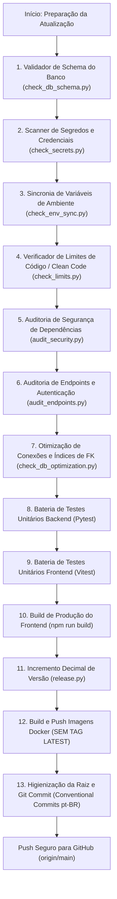

# 🚀 Automações e Validações Pré-Push / Pré-Release (GitHub)

Este documento descreve detalhadamente todas as **automações, verificadores de integridade, scripts de segurança e testes** executados no projeto **NexusChat (Projeto - Discord)** antes de qualquer envio de atualização ao repositório GitHub (`https://github.com/aryarajalves/projeto-base.git`).

---

## 📌 Visão Geral do Fluxo Pré-Push

Antes de commitar e subir alterações para a branch `main`, o projeto conta com uma esteira rigorosa de **10 etapas automatizadas** que impedem quebras em produção, vazamentos de credenciais, regressões visuais/lógicas ou falhas de segurança.



---

## 🛠️ Detalhamento de Cada Automação

### 1. 🔍 Verificador de Esquema de Banco de Dados (`scripts/check_db_schema.py`)
- **Objetivo:** Garantir que 100% dos modelos SQLAlchemy (`backend/app/models/*.py`) estejam sincronizados com o bloco de inicialização automática (`lifespan` em `backend/app/main.py`).
- **O que faz:**
  - Extrai todas as tabelas e colunas dos modelos Python.
  - Varre as declarações SQL `CREATE TABLE IF NOT EXISTS` e `ALTER TABLE ... ADD COLUMN IF NOT EXISTS` do `main.py`.
  - Compara ambos os lados e detecta tabelas ou colunas esquecidas.
  - Se houver divergência, gera automaticamente o código SQL pronto para inserção no `main.py` e bloqueia a release.
- **Comando manual:**
  ```bash
  python scripts/check_db_schema.py
  ```

---

### 2. 🔐 Scanner de Segredos e Credenciais (`scripts/check_secrets.py`)
- **Objetivo:** Evitar vazamento acidental de chaves de API, senhas e certificados privados no histórico do Git.
- **O que faz:**
  - Varre todos os arquivos rastreados pelo repositório.
  - Busca padrões regex de chaves reais (OpenAI, GitHub Tokens, Chaves Privadas PEM, Brevo, AWS, Slack).
  - Bloqueia commits se arquivos `.env` com dados sensíveis estiverem staged para o Git.
  - Mascara qualquer segredo impresso no terminal (`sk-****1234`).
- **Comando manual:**
  ```bash
  python scripts/check_secrets.py
  ```

---

### 3. ⚙️ Sincronizador de Variáveis de Ambiente (`scripts/check_env_sync.py`)
- **Objetivo:** Garantir a portabilidade do sistema para qualquer novo servidor ou ambiente de homologação/produção.
- **O que faz:**
  - Faz um scanner estático em todos os arquivos `.py` do backend procurando chamadas a `os.getenv("VAR")` e `os.environ.get("VAR")`.
  - Lê o arquivo `backend/.env.example`.
  - Verifica se todas as variáveis utilizadas no código estão presentes e documentadas no `.env.example`.
  - Se faltar alguma variável, lista exatamente as pendências e interrompe o fluxo.
- **Comando manual:**
  ```bash
  python scripts/check_env_sync.py
  ```

---

### 4. 📏 Validador de Limites de Código / Clean Code (`scripts/check_limits.py`)
- **Objetivo:** Prevenir a criação de arquivos monolíticos, assegurando manutenibilidade e modularização contínua.
- **Regras estritas:**
  - **Backend (Python):** Máximo de **1.000 linhas** por arquivo.
  - **Frontend (React/JSX/CSS):** Máximo de **500 linhas** por arquivo.
- **O que faz:**
  - Varre recursivamente `frontend/src` e `backend`.
  - Lista os arquivos ordenados pela quantidade de linhas.
  - Acusa imediatamente qualquer arquivo que ultrapasse o teto permitido para que seja modularizado antes do push.
- **Comando manual:**
  ```bash
  python scripts/check_limits.py
  ```

---

### 5. 🛡️ Auditoria Unificada de Segurança de Dependências (`scripts/audit_security.py`)
- **Objetivo:** Garantir que nenhuma biblioteca com vulnerabilidades conhecidas (CVEs) suba para o repositório ou imagens Docker.
- **O que faz:**
  - **Backend:** Executa `pip-audit` contra o `backend/requirements.txt`. Exige **0 vulnerabilidades críticas**.
  - **Frontend:** Executa `npm audit` dentro de `frontend/`. Exige **0 vulnerabilidades**.
  - Se qualquer dependência apresentar falha de segurança, o push é **terminantemente bloqueado**.
- **Comando manual:**
  ```bash
  python scripts/audit_security.py
  ```

---

### 6. 🌐 Auditoria de Endpoints e Autenticação (`scripts/audit_endpoints.py`)
- **Objetivo:** Garantir resiliência, proteção contra acessos não autorizados e documentação completa da API REST FastAPI.
- **O que faz:**
  - Varre todos os roteadores da API (`backend/app/api/v1/endpoints/`).
  - Confere se as rotas privadas exigem injeção de autenticação (`get_current_user`, `require_admin`, `require_superadmin`, etc.).
  - Isenta apenas rotas estritamente públicas devidamente identificadas (`/login`, `/register`, `/attachments/{filename}`, etc.).
- **Comando manual:**
  ```bash
  python scripts/audit_endpoints.py
  ```

---

### 7. ⚡ Auditoria de Otimização de Conexões e Banco de Dados (`scripts/check_db_optimization.py`)
- **Objetivo:** Garantir alta performance relacional sob alto tráfego e prevenir exaustão de conexões, vazamento de sessões ou Full Table Scans.
- **O que faz:**
  - **1/4 - Connection Pooling:** Confere parâmetros de robustez do engine SQLAlchemy (`DB_POOL_SIZE=20`, `DB_MAX_OVERFLOW=30`, `pool_pre_ping=True`).
  - **2/4 - Índices em Chaves Estrangeiras (ForeignKeys):** Varre 100% dos modelos (39 ForeignKeys) e assegura que **100% delas possuam índices explícitos** (`index=True`).
  - **3/4 - Vazamento de Sessões (Session Leaks):** Varre o backend procurando chamadas manuais a `SessionLocal()` e garante que possuem fechamento estrito em blocos `try/finally: db.close()` ou context managers `with get_db_context()`.
  - **4/4 - Prevenção de Consultas N+1:** Assegura que consultas de mensagens utilizem estratégias de carregamento antecipado e relacionamentos eficientes.
- **Comando manual:**
  ```bash
  python scripts/check_db_optimization.py
  ```

---

### 8. 🧪 Bateria de Testes Unitários Automatizados
- **Objetivo:** Garantir ausência total de bugs funcionais e regressões antes do commit.
- **Backend (Pytest):**
  ```bash
  docker exec nexus_chat_backend pytest -q --tb=short tests/
  ```
- **Frontend (Vitest):**
  ```bash
  npm test -- --run
  ```

---

### 9. 📦 Build de Produção do Frontend
- **Objetivo:** Gerar o bundle compilado e otimizado para o Nginx.
- **O que faz:**
  - Executa `npm run build` na pasta `frontend/`.
  - Valida tipagens, sintaxe JSX e gera os assets finais em `frontend/dist`.

---

### 10. 🔢 Versionamento Semântico Decimal e Orquestração (`scripts/release.py`)
- **Objetivo:** Orquestrar todas as etapas anteriores em um comando único e gerenciar a numeração de versão.
- **Regra de Versão Decimal (Base 10):**
  - Formato `X.Y.Z`:
    - Incrementa `Z` de 1 em 1.
    - Se `Z > 9`, `Z = 0` e incrementa `Y`.
    - Se `Y > 9`, `Y = 0` e incrementa `X`.
    - *Exemplos:* `1.0.7` ➔ `1.0.8` ➔ `1.0.9` ➔ `1.1.0` ➔ `2.0.0`.
- **Atualização Automática de Arquivos:**
  - `frontend/package.json`
  - `docker/docker-compose-producao.yml`
  - `README.md`
- **Regra Rígida de Tags Docker:**
  - **PROIBIDO usar tag `:latest`**.
  - As tags são sempre imutáveis: `backend-X.Y.Z` e `frontend-X.Y.Z`.
- **Comandos de execução:**
  ```bash
  # Execução completa da esteira de validação e release:
  python scripts/release.py

  # Simulação (dry-run) para testar validações sem alterar arquivos:
  python scripts/release.py --dry-run
  ```

---

## 📋 Resumo dos Comandos em Tabela

| Etapa | Script / Comando | Responsabilidade Principal | Bloqueia Release? |
|---|---|---|:---:|
| **1. Banco de Dados** | `python scripts/check_db_schema.py` | Checar sincronia Models SQLAlchemy vs `main.py` | Sim |
| **2. Segredos** | `python scripts/check_secrets.py` | Detectar chaves de API, senhas e tokens reais | Sim |
| **3. Variáveis** | `python scripts/check_env_sync.py` | Garantir que `os.getenv` está no `.env.example` | Sim |
| **4. Clean Code** | `python scripts/check_limits.py` | Checar teto de linhas (Backend: 1000, Frontend: 500) | Sim |
| **5. Dependências** | `python scripts/audit_security.py` | `pip-audit` e `npm audit` (0 vulnerabilidades) | Sim |
| **6. APIs / Endpoints** | `python scripts/audit_endpoints.py` | Documentação OpenAPI e Autenticação de Rotas | Sim |
| **7. Otimização DB** | `python scripts/check_db_optimization.py` | 100% de FKs com índice, pool e zero leaks | Sim |
| **8. Testes Backend** | `docker exec nexus_chat_backend pytest` | Validação funcional de regras e endpoints | Sim |
| **9. Testes Frontend** | `npm test -- --run` | Validação de componentes e hooks Vitest | Sim |
| **10. Frontend Build** | `npm run build` | Compilar versão final do Nginx (`frontend/dist`) | Sim |
| **11. Esteira Completa** | `python scripts/release.py` | Executa todas as etapas e calcula versão decimal | Sim |
